# Jarkom Modul 5 K-46

| 	Nama              	| NRP        | Pembagian Pengerjaaan  |
| ---------------------	| ---------- | ---------------------- |
| Hendra Manudinata 	| 5027251051 | Babak 1 (soal 1-8) dan Babak 3 (soal 13-19) |
| Daffa Rifqi As Shidiq	| 5027251038 | Babak 2 (soal 9-12) |

* Kelompok: K-46
* Prefix IP: 192.234.x.x
* Project GNS3: `K-46-MODUL-5`

Struktur repository:

* `subnetting/` berisi tabel VLSM (`vlsm.md`, `vlsm.csv`), IP tiap node (`ip-node.csv`), dan pohon IP (`pohon-ip.png`, `pohon-ip.svg`).
* `perquest-scripts/soal_N/<node>.sh` berisi script tiap soal. Script dikirim ke node sebagai `/root/soal_N.sh` lalu dijalankan.

---

## Soal 1
**Markas tanpa peta:** tengah malam alarm meraung, dan Ritsuko terdiam. Markas sebesar ini dibangun tanpa peta alamat. Gendo anti pemborosan, jadi tiap subnet memakai **prefix terkecil yang muat**. Bagi prefix IP kelompokmu dengan **VLSM** untuk **17 LAN dan 16 link antar-router**, urut dari kebutuhan terbesar. Tunjukkan **tabel** berisi network, prefix, gateway, broadcast, IP terpakai, dan sisa. Tunjukkan juga **gambar pohon IP**, dengan subnet jalur **Dummy-Plug ke Armisael dilingkari**. Di laporan, jelaskan hitungan satu subnet.

### Jawaban dan Penjelasan

#### 1. Aturan Pembagian

* Kebutuhan alamat tiap LAN = jumlah host + 1 (gateway). Link antar-router selalu butuh 2 alamat.
* Prefix dipilih yang terkecil dengan jumlah usable `2^(32 - prefix) - 2` yang masih muat.
* Subnet diurutkan dari blok terbesar. Jika ukurannya sama, LAN didahulukan daripada link, lalu mengikuti urutan tabel.
* Gateway memakai IP usable pertama. Node pada switch memakai IP berikutnya sesuai urutan nama di gambar (kiri ke kanan).
* Pada link, IP pertama untuk router atas (arah Gendou) dan IP kedua untuk router bawah.
* Urutan link disusun agar subnet satu cabang bisa diringkas tepat menjadi satu CIDR pada soal 3.

#### 2. Tabel VLSM

<details>
<summary>Tabel VLSM (33 subnet: 17 LAN + 16 link)</summary>

| No | Subnet | Kebutuhan | Prefix | Network | Gateway | Broadcast | Usable | Terpakai | Sisa |
|---|---|---|---|---|---|---|---|---|---|
| 1 | Switch-Quarters | 501 | /23 | 192.234.0.0 | 192.234.0.1 | 192.234.1.255 | 510 | 501 | 9 |
| 2 | Switch-Comm | 201 | /24 | 192.234.2.0 | 192.234.2.1 | 192.234.2.255 | 254 | 201 | 53 |
| 3 | Switch-Hangar | 101 | /25 | 192.234.3.0 | 192.234.3.1 | 192.234.3.127 | 126 | 101 | 25 |
| 4 | Switch-Bunker | 56 | /26 | 192.234.3.128 | 192.234.3.129 | 192.234.3.191 | 62 | 56 | 6 |
| 5 | Switch-Medic | 27 | /27 | 192.234.3.192 | 192.234.3.193 | 192.234.3.223 | 30 | 27 | 3 |
| 6 | Switch-Relay | 26 | /27 | 192.234.3.224 | 192.234.3.225 | 192.234.3.255 | 30 | 26 | 4 |
| 7 | Switch-Garden | 15 | /27 | 192.234.4.0 | 192.234.4.1 | 192.234.4.31 | 30 | 15 | 15 |
| 8 | Switch-Dock | 13 | /28 | 192.234.4.32 | 192.234.4.33 | 192.234.4.47 | 14 | 13 | 1 |
| 9 | Switch-Lab | 6 | /29 | 192.234.4.48 | 192.234.4.49 | 192.234.4.55 | 6 | 6 | 0 |
| 10 | Switch-Terminal | 4 | /29 | 192.234.4.56 | 192.234.4.57 | 192.234.4.63 | 6 | 4 | 2 |
| 11 | Switch-Cage | 4 | /29 | 192.234.4.64 | 192.234.4.65 | 192.234.4.71 | 6 | 4 | 2 |
| 12 | Switch-Dogma | 3 | /29 | 192.234.4.72 | 192.234.4.73 | 192.234.4.79 | 6 | 3 | 3 |
| 13 | Switch-Monolith | 3 | /29 | 192.234.4.80 | 192.234.4.81 | 192.234.4.87 | 6 | 3 | 3 |
| 14 | Switch-Radar | 5 | /29 | 192.234.4.88 | 192.234.4.89 | 192.234.4.95 | 6 | 5 | 1 |
| 15 | Switch-Archive | 2 | /30 | 192.234.4.96 | 192.234.4.97 | 192.234.4.99 | 2 | 2 | 0 |
| 16 | Switch-Intel | 2 | /30 | 192.234.4.100 | 192.234.4.101 | 192.234.4.103 | 2 | 2 | 0 |
| 17 | Switch-Cmd | 2 | /30 | 192.234.4.104 | 192.234.4.105 | 192.234.4.107 | 2 | 2 | 0 |
| 18 | L1 Gendou-Hikari | 2 | /30 | 192.234.4.108 | 192.234.4.109 | 192.234.4.111 | 2 | 2 | 0 |
| 19 | L2 Gendou-Yui | 2 | /30 | 192.234.4.112 | 192.234.4.113 | 192.234.4.115 | 2 | 2 | 0 |
| 20 | L3 Yui-Mari | 2 | /30 | 192.234.4.116 | 192.234.4.117 | 192.234.4.119 | 2 | 2 | 0 |
| 21 | L4 Yui-Rei | 2 | /30 | 192.234.4.120 | 192.234.4.121 | 192.234.4.123 | 2 | 2 | 0 |
| 22 | L5 Yui-Shinji | 2 | /30 | 192.234.4.124 | 192.234.4.125 | 192.234.4.127 | 2 | 2 | 0 |
| 23 | L6 Asuka-Kensuke | 2 | /30 | 192.234.4.128 | 192.234.4.129 | 192.234.4.131 | 2 | 2 | 0 |
| 24 | L7 Asuka-Ritsuko | 2 | /30 | 192.234.4.132 | 192.234.4.133 | 192.234.4.135 | 2 | 2 | 0 |
| 25 | L8 Fuyutsuki-Maya | 2 | /30 | 192.234.4.136 | 192.234.4.137 | 192.234.4.139 | 2 | 2 | 0 |
| 26 | L9 Fuyutsuki-Toji | 2 | /30 | 192.234.4.140 | 192.234.4.141 | 192.234.4.143 | 2 | 2 | 0 |
| 27 | L10 Hikari-Kaworu | 2 | /30 | 192.234.4.144 | 192.234.4.145 | 192.234.4.147 | 2 | 2 | 0 |
| 28 | L11 Shigeru-Makoto | 2 | /30 | 192.234.4.148 | 192.234.4.149 | 192.234.4.151 | 2 | 2 | 0 |
| 29 | L12 Gendou-Asuka | 2 | /30 | 192.234.4.152 | 192.234.4.153 | 192.234.4.155 | 2 | 2 | 0 |
| 30 | L13 Gendou-Kaji | 2 | /30 | 192.234.4.156 | 192.234.4.157 | 192.234.4.159 | 2 | 2 | 0 |
| 31 | L14 Gendou-Misato | 2 | /30 | 192.234.4.160 | 192.234.4.161 | 192.234.4.163 | 2 | 2 | 0 |
| 32 | L15 Gendou-Shigeru | 2 | /30 | 192.234.4.164 | 192.234.4.165 | 192.234.4.167 | 2 | 2 | 0 |
| 33 | L16 Gendou-Fuyutsuki | 2 | /30 | 192.234.4.168 | 192.234.4.169 | 192.234.4.171 | 2 | 2 | 0 |

</details>

Total alokasi adalah `192.234.0.0` sampai `192.234.4.171`. Tabel lengkap dengan netmask dan range ada di [`subnetting/vlsm.md`](subnetting/vlsm.md), sedangkan IP tiap node ada di [`subnetting/ip-node.csv`](subnetting/ip-node.csv).

#### 3. Hitungan Satu Subnet: Switch-Garden

1. Kebutuhan: Garden-Staff 14 host + 1 gateway (Shinji) = **15 alamat**.
2. Prefix /28 memberi `2^4 - 2 = 14` usable, sehingga **tidak muat**. Prefix /27 memberi `2^5 - 2 = 30` usable, sehingga dipakai **/27** (netmask `255.255.255.224`).
3. Subnet sebelumnya (Switch-Relay `192.234.3.224/27`) berakhir di `192.234.3.255`, sehingga Switch-Garden dimulai di `192.234.4.0`.
4. Blok /27 berisi 32 alamat, yaitu `192.234.4.0` sampai `192.234.4.31`:
   * Network: `192.234.4.0`
   * Gateway (Shinji): `192.234.4.1`
   * Garden-Staff: `192.234.4.2`
   * Broadcast: `192.234.4.31`
5. Terpakai 15 dari 30 usable, sehingga sisa 15.

#### 4. Pohon IP

Subnet pada jalur Dummy-Plug ke Armisael digambar sebagai lingkaran merah: Switch-Lab (`192.234.4.48/29`), L7 Asuka-Ritsuko (`192.234.4.132/30`), L12 Gendou-Asuka (`192.234.4.152/30`), L15 Gendou-Shigeru (`192.234.4.164/30`), dan Switch-Monolith (`192.234.4.80/29`).

```mermaid
flowchart LR
    n192_234_0_0_21["192.234.0.0/21"]
    n192_234_0_0_22["192.234.0.0/22"]
    n192_234_0_0_23["192.234.0.0/23<br/>Switch-Quarters"]:::used
    n192_234_2_0_23["192.234.2.0/23"]
    n192_234_2_0_24["192.234.2.0/24<br/>Switch-Comm"]:::used
    n192_234_3_0_24["192.234.3.0/24"]
    n192_234_3_0_25["192.234.3.0/25<br/>Switch-Hangar"]:::used
    n192_234_3_128_25["192.234.3.128/25"]
    n192_234_3_128_26["192.234.3.128/26<br/>Switch-Bunker"]:::used
    n192_234_3_192_26["192.234.3.192/26"]
    n192_234_3_192_27["192.234.3.192/27<br/>Switch-Medic"]:::used
    n192_234_3_224_27["192.234.3.224/27<br/>Switch-Relay"]:::used
    n192_234_4_0_22["192.234.4.0/22"]
    n192_234_4_0_23["192.234.4.0/23"]
    n192_234_4_0_24["192.234.4.0/24"]
    n192_234_4_0_25["192.234.4.0/25"]
    n192_234_4_0_26["192.234.4.0/26"]
    n192_234_4_0_27["192.234.4.0/27<br/>Switch-Garden"]:::used
    n192_234_4_32_27["192.234.4.32/27"]
    n192_234_4_32_28["192.234.4.32/28<br/>Switch-Dock"]:::used
    n192_234_4_48_28["192.234.4.48/28"]
    n192_234_4_48_29(("192.234.4.48/29<br/><b>Switch-Lab</b>")):::hot
    n192_234_4_56_29["192.234.4.56/29<br/>Switch-Terminal"]:::used
    n192_234_4_64_26["192.234.4.64/26"]
    n192_234_4_64_27["192.234.4.64/27"]
    n192_234_4_64_28["192.234.4.64/28"]
    n192_234_4_64_29["192.234.4.64/29<br/>Switch-Cage"]:::used
    n192_234_4_72_29["192.234.4.72/29<br/>Switch-Dogma"]:::used
    n192_234_4_80_28["192.234.4.80/28"]
    n192_234_4_80_29(("192.234.4.80/29<br/><b>Switch-Monolith</b>")):::hot
    n192_234_4_88_29["192.234.4.88/29<br/>Switch-Radar"]:::used
    n192_234_4_96_27["192.234.4.96/27"]
    n192_234_4_96_28["192.234.4.96/28"]
    n192_234_4_96_29["192.234.4.96/29"]
    n192_234_4_96_30["192.234.4.96/30<br/>Switch-Archive"]:::used
    n192_234_4_100_30["192.234.4.100/30<br/>Switch-Intel"]:::used
    n192_234_4_104_29["192.234.4.104/29"]
    n192_234_4_104_30["192.234.4.104/30<br/>Switch-Cmd"]:::used
    n192_234_4_108_30["192.234.4.108/30<br/>L1 Gendou-Hikari"]:::used
    n192_234_4_112_28["192.234.4.112/28"]
    n192_234_4_112_29["192.234.4.112/29"]
    n192_234_4_112_30["192.234.4.112/30<br/>L2 Gendou-Yui"]:::used
    n192_234_4_116_30["192.234.4.116/30<br/>L3 Yui-Mari"]:::used
    n192_234_4_120_29["192.234.4.120/29"]
    n192_234_4_120_30["192.234.4.120/30<br/>L4 Yui-Rei"]:::used
    n192_234_4_124_30["192.234.4.124/30<br/>L5 Yui-Shinji"]:::used
    n192_234_4_128_25["192.234.4.128/25"]
    n192_234_4_128_26["192.234.4.128/26"]
    n192_234_4_128_27["192.234.4.128/27"]
    n192_234_4_128_28["192.234.4.128/28"]
    n192_234_4_128_29["192.234.4.128/29"]
    n192_234_4_128_30["192.234.4.128/30<br/>L6 Asuka-Kensuke"]:::used
    n192_234_4_132_30(("192.234.4.132/30<br/><b>L7 Asuka-Ritsuko</b>")):::hot
    n192_234_4_136_29["192.234.4.136/29"]
    n192_234_4_136_30["192.234.4.136/30<br/>L8 Fuyutsuki-Maya"]:::used
    n192_234_4_140_30["192.234.4.140/30<br/>L9 Fuyutsuki-Toji"]:::used
    n192_234_4_144_28["192.234.4.144/28"]
    n192_234_4_144_29["192.234.4.144/29"]
    n192_234_4_144_30["192.234.4.144/30<br/>L10 Hikari-Kaworu"]:::used
    n192_234_4_148_30["192.234.4.148/30<br/>L11 Shigeru-Makoto"]:::used
    n192_234_4_152_29["192.234.4.152/29"]
    n192_234_4_152_30(("192.234.4.152/30<br/><b>L12 Gendou-Asuka</b>")):::hot
    n192_234_4_156_30["192.234.4.156/30<br/>L13 Gendou-Kaji"]:::used
    n192_234_4_160_27["192.234.4.160/27"]
    n192_234_4_160_28["192.234.4.160/28"]
    n192_234_4_160_29["192.234.4.160/29"]
    n192_234_4_160_30["192.234.4.160/30<br/>L14 Gendou-Misato"]:::used
    n192_234_4_164_30(("192.234.4.164/30<br/><b>L15 Gendou-Shigeru</b>")):::hot
    n192_234_4_168_29["192.234.4.168/29"]
    n192_234_4_168_30["192.234.4.168/30<br/>L16 Gendou-Fuyutsuki"]:::used
    n192_234_4_172_30["192.234.4.172/30<br/>(sisa)"]:::sisa
    n192_234_4_176_28["192.234.4.176/28<br/>(sisa)"]:::sisa
    n192_234_4_192_26["192.234.4.192/26<br/>(sisa)"]:::sisa
    n192_234_5_0_24["192.234.5.0/24<br/>(sisa)"]:::sisa
    n192_234_6_0_23["192.234.6.0/23<br/>(sisa)"]:::sisa
    n192_234_0_0_21 --> n192_234_0_0_22
    n192_234_0_0_22 --> n192_234_0_0_23
    n192_234_0_0_22 --> n192_234_2_0_23
    n192_234_2_0_23 --> n192_234_2_0_24
    n192_234_2_0_23 --> n192_234_3_0_24
    n192_234_3_0_24 --> n192_234_3_0_25
    n192_234_3_0_24 --> n192_234_3_128_25
    n192_234_3_128_25 --> n192_234_3_128_26
    n192_234_3_128_25 --> n192_234_3_192_26
    n192_234_3_192_26 --> n192_234_3_192_27
    n192_234_3_192_26 --> n192_234_3_224_27
    n192_234_0_0_21 --> n192_234_4_0_22
    n192_234_4_0_22 --> n192_234_4_0_23
    n192_234_4_0_23 --> n192_234_4_0_24
    n192_234_4_0_24 --> n192_234_4_0_25
    n192_234_4_0_25 --> n192_234_4_0_26
    n192_234_4_0_26 --> n192_234_4_0_27
    n192_234_4_0_26 --> n192_234_4_32_27
    n192_234_4_32_27 --> n192_234_4_32_28
    n192_234_4_32_27 --> n192_234_4_48_28
    n192_234_4_48_28 --> n192_234_4_48_29
    n192_234_4_48_28 --> n192_234_4_56_29
    n192_234_4_0_25 --> n192_234_4_64_26
    n192_234_4_64_26 --> n192_234_4_64_27
    n192_234_4_64_27 --> n192_234_4_64_28
    n192_234_4_64_28 --> n192_234_4_64_29
    n192_234_4_64_28 --> n192_234_4_72_29
    n192_234_4_64_27 --> n192_234_4_80_28
    n192_234_4_80_28 --> n192_234_4_80_29
    n192_234_4_80_28 --> n192_234_4_88_29
    n192_234_4_64_26 --> n192_234_4_96_27
    n192_234_4_96_27 --> n192_234_4_96_28
    n192_234_4_96_28 --> n192_234_4_96_29
    n192_234_4_96_29 --> n192_234_4_96_30
    n192_234_4_96_29 --> n192_234_4_100_30
    n192_234_4_96_28 --> n192_234_4_104_29
    n192_234_4_104_29 --> n192_234_4_104_30
    n192_234_4_104_29 --> n192_234_4_108_30
    n192_234_4_96_27 --> n192_234_4_112_28
    n192_234_4_112_28 --> n192_234_4_112_29
    n192_234_4_112_29 --> n192_234_4_112_30
    n192_234_4_112_29 --> n192_234_4_116_30
    n192_234_4_112_28 --> n192_234_4_120_29
    n192_234_4_120_29 --> n192_234_4_120_30
    n192_234_4_120_29 --> n192_234_4_124_30
    n192_234_4_0_24 --> n192_234_4_128_25
    n192_234_4_128_25 --> n192_234_4_128_26
    n192_234_4_128_26 --> n192_234_4_128_27
    n192_234_4_128_27 --> n192_234_4_128_28
    n192_234_4_128_28 --> n192_234_4_128_29
    n192_234_4_128_29 --> n192_234_4_128_30
    n192_234_4_128_29 --> n192_234_4_132_30
    n192_234_4_128_28 --> n192_234_4_136_29
    n192_234_4_136_29 --> n192_234_4_136_30
    n192_234_4_136_29 --> n192_234_4_140_30
    n192_234_4_128_27 --> n192_234_4_144_28
    n192_234_4_144_28 --> n192_234_4_144_29
    n192_234_4_144_29 --> n192_234_4_144_30
    n192_234_4_144_29 --> n192_234_4_148_30
    n192_234_4_144_28 --> n192_234_4_152_29
    n192_234_4_152_29 --> n192_234_4_152_30
    n192_234_4_152_29 --> n192_234_4_156_30
    n192_234_4_128_26 --> n192_234_4_160_27
    n192_234_4_160_27 --> n192_234_4_160_28
    n192_234_4_160_28 --> n192_234_4_160_29
    n192_234_4_160_29 --> n192_234_4_160_30
    n192_234_4_160_29 --> n192_234_4_164_30
    n192_234_4_160_28 --> n192_234_4_168_29
    n192_234_4_168_29 --> n192_234_4_168_30
    n192_234_4_168_29 --> n192_234_4_172_30
    n192_234_4_160_27 --> n192_234_4_176_28
    n192_234_4_128_25 --> n192_234_4_192_26
    n192_234_4_0_23 --> n192_234_5_0_24
    n192_234_4_0_22 --> n192_234_6_0_23
    classDef used fill:#e8f1fb,stroke:#557,color:#000
    classDef sisa fill:#f3f3f3,stroke:#aaa,color:#888,stroke-dasharray:4 3
    classDef hot fill:#fde2e2,stroke:#d00,stroke-width:3px,color:#d00
```



Setiap cabang membagi blok induknya menjadi dua bagian sama besar, dari `192.234.0.0/21` sampai prefix tiap subnet. Kotak biru adalah subnet terpakai, dan kotak abu-abu putus-putus adalah sisa yang belum dialokasikan. Versi gambar statis tersedia di `subnetting/pohon-ip.png`.


## Soal 2
**Geofront gelap gulita:** kabel sudah ditarik, tapi saat Misato menekan tombol daya, Geofront tetap gelap. Tidak ada alamat dan tidak ada rute. Pasang semua node di GNS3 sesuai topologi. Beri IP ke tiap interface router sesuai soal 1, lalu aktifkan **IP forwarding** di semua router. Hanya **Gendou** yang terhubung ke NAT1 dan mendapat alamat lewat **DHCP**. Router lain baru bisa memasang paket setelah soal 4, karena internet baru ada saat itu. Tunjukkan `ip -br` di tiap router dan ping dua ujung tiap link router ke router.

### Jawaban dan Penjelasan

#### 1. Topologi GNS3

Topologi berisi 17 router, 17 switch, 25 host, dan NAT1 dengan total 59 link. Semua router dan host memakai image `ardhptr21/alpinet:latest`, kecuali Magi-Casper, Magi-Balthasar, dan Magi-Melchior yang memakai `ardhptr21/debinet:latest` karena soal 7 membutuhkan paket `netcat-traditional`.

Pemetaan interface pada setiap router dibuat seragam:

* `eth0` selalu menuju router di atasnya (Gendou menuju NAT1).
* `eth1` selalu menuju switch LAN milik router tersebut.
* `eth2` dan seterusnya menuju router di bawahnya.

<details>
<summary>Pemetaan interface 17 router</summary>

| Router | eth0 | eth1 | eth2 | eth3 | eth4 | eth5–eth8 |
|---|---|---|---|---|---|---|
| Gendou | NAT1 (DHCP) | Switch-Cmd `.4.105/30` | Yui `.4.113/30` | Hikari `.4.109/30` | Asuka `.4.153/30` | Kaji `.4.157`, Misato `.4.161`, Shigeru `.4.165`, Fuyutsuki `.4.169` (/30) |
| Yui | Gendou `.4.114/30` | Switch-Hangar `.3.1/25` | Mari `.4.117/30` | Rei `.4.121/30` | Shinji `.4.125/30` | |
| Mari | Yui `.4.118/30` | Switch-Dock `.4.33/28` | | | | |
| Rei | Yui `.4.122/30` | Switch-Quarters `.0.1/23` | | | | |
| Shinji | Yui `.4.126/30` | Switch-Garden `.4.1/27` | | | | |
| Hikari | Gendou `.4.110/30` | Switch-Comm `.2.1/24` | Kaworu `.4.145/30` | | | |
| Kaworu | Hikari `.4.146/30` | Switch-Relay `.3.225/27` | | | | |
| Asuka | Gendou `.4.154/30` | Switch-Archive `.4.97/30` | Kensuke `.4.129/30` | Ritsuko `.4.133/30` | | |
| Kensuke | Asuka `.4.130/30` | Switch-Bunker `.3.129/26` | | | | |
| Ritsuko | Asuka `.4.134/30` | Switch-Lab `.4.49/29` | | | | |
| Kaji | Gendou `.4.158/30` | Switch-Intel `.4.101/30` | | | | |
| Misato | Gendou `.4.162/30` | Switch-Cage `.4.65/29` | | | | |
| Shigeru | Gendou `.4.166/30` | Switch-Monolith `.4.81/29` | Makoto `.4.149/30` | | | |
| Makoto | Shigeru `.4.150/30` | Switch-Radar `.4.89/29` | | | | |
| Fuyutsuki | Gendou `.4.170/30` | Switch-Terminal `.4.57/29` | Maya `.4.137/30` | Toji `.4.141/30` | | |
| Maya | Fuyutsuki `.4.138/30` | Switch-Medic `.3.193/27` | | | | |
| Toji | Fuyutsuki `.4.142/30` | Switch-Dogma `.4.73/29` | | | | |

Semua alamat di atas berawalan `192.234.`.

</details>

#### 2. Konfigurasi `Gendou`

Gendou adalah satu-satunya router yang terhubung ke NAT1, sehingga `eth0` memakai DHCP. Interface lainnya diberi IP statis sesuai tabel VLSM.

```bash
auto eth0
iface eth0 inet dhcp
    up sysctl -w net.ipv4.ip_forward=1

# Switch-Cmd
auto eth1
iface eth1 inet static
    address 192.234.4.105
    netmask 255.255.255.252

# L2 ke Yui
auto eth2
iface eth2 inet static
    address 192.234.4.113
    netmask 255.255.255.252

# ... eth3 sampai eth8 mengikuti pola yang sama
```

Konfigurasi ditulis ke `/etc/network/interfaces`, yang diterapkan ulang oleh GNS3 setiap kali node dinyalakan, sehingga IP bertahan setelah restart. Baris `up sysctl -w net.ipv4.ip_forward=1` memastikan IP forwarding aktif setiap kali interface naik. Agar langsung berlaku tanpa restart, script juga menerapkan konfigurasi saat itu juga:

```bash
ip link set eth0 up
udhcpc -i eth0 -n -q
ip addr flush dev eth1; ip addr add 192.234.4.105/30 dev eth1; ip link set eth1 up
# ... dan seterusnya untuk eth2 sampai eth8
sysctl -w net.ipv4.ip_forward=1
```

#### 3. Konfigurasi Router Lain

Router lain memakai pola yang sama, hanya saja semua interface statis. Sebagai contoh, konfigurasi `Asuka`:

```bash
# L12 ke Gendou
auto eth0
iface eth0 inet static
    address 192.234.4.154
    netmask 255.255.255.252
    up sysctl -w net.ipv4.ip_forward=1

# Switch-Archive
auto eth1
iface eth1 inet static
    address 192.234.4.97
    netmask 255.255.255.252

# L6 ke Kensuke
auto eth2
iface eth2 inet static
    address 192.234.4.129
    netmask 255.255.255.252

# L7 ke Ritsuko
auto eth3
iface eth3 inet static
    address 192.234.4.133
    netmask 255.255.255.252
```

Script lengkap tiap router ada di `perquest-scripts/soal_2/<router>.sh` dan dijalankan di node sebagai `/root/soal_2.sh`. Pada soal ini belum ada rute antar-subnet, sehingga yang bisa saling ping hanya dua ujung link yang terhubung langsung. Rute dibuat pada soal 3.

### Verifikasi

#### 1. Verifikasi `Gendou`

```bash
ip -4 -br addr
ping -c 2 192.168.122.1      # NAT1
ping -c 2 192.234.4.114      # Yui (dan seterusnya untuk 7 link lainnya)
```

```
lo               UNKNOWN        127.0.0.1/8
eth0             UNKNOWN        192.168.122.172/24
eth1             UNKNOWN        192.234.4.105/30
eth2             UNKNOWN        192.234.4.113/30
eth3             UNKNOWN        192.234.4.109/30
eth4             UNKNOWN        192.234.4.153/30
eth5             UNKNOWN        192.234.4.157/30
eth6             UNKNOWN        192.234.4.161/30
eth7             UNKNOWN        192.234.4.165/30
eth8             UNKNOWN        192.234.4.169/30
```

`eth0` mendapat `192.168.122.172/24` dari DHCP NAT1, dan `eth1` sampai `eth8` sudah memiliki IP sesuai tabel. Ping ke NAT1 dan ke tujuh router tetangga (Yui, Hikari, Asuka, Kaji, Misato, Shigeru, Fuyutsuki) menghasilkan 0% packet loss.

#### 2. Verifikasi Link Router ke Router

Ping dijalankan dari kedua ujung setiap link. Seluruh 16 link berhasil dengan 0% packet loss:

<details>
<summary>Hasil ping 16 link router ke router</summary>

| Link | Ujung atas | Ujung bawah | Hasil |
|---|---|---|---|
| L1 Gendou-Hikari | 192.234.4.109 | 192.234.4.110 | 0% loss dua arah |
| L2 Gendou-Yui | 192.234.4.113 | 192.234.4.114 | 0% loss dua arah |
| L3 Yui-Mari | 192.234.4.117 | 192.234.4.118 | 0% loss dua arah |
| L4 Yui-Rei | 192.234.4.121 | 192.234.4.122 | 0% loss dua arah |
| L5 Yui-Shinji | 192.234.4.125 | 192.234.4.126 | 0% loss dua arah |
| L6 Asuka-Kensuke | 192.234.4.129 | 192.234.4.130 | 0% loss dua arah |
| L7 Asuka-Ritsuko | 192.234.4.133 | 192.234.4.134 | 0% loss dua arah |
| L8 Fuyutsuki-Maya | 192.234.4.137 | 192.234.4.138 | 0% loss dua arah |
| L9 Fuyutsuki-Toji | 192.234.4.141 | 192.234.4.142 | 0% loss dua arah |
| L10 Hikari-Kaworu | 192.234.4.145 | 192.234.4.146 | 0% loss dua arah |
| L11 Shigeru-Makoto | 192.234.4.149 | 192.234.4.150 | 0% loss dua arah |
| L12 Gendou-Asuka | 192.234.4.153 | 192.234.4.154 | 0% loss dua arah |
| L13 Gendou-Kaji | 192.234.4.157 | 192.234.4.158 | 0% loss dua arah |
| L14 Gendou-Misato | 192.234.4.161 | 192.234.4.162 | 0% loss dua arah |
| L15 Gendou-Shigeru | 192.234.4.165 | 192.234.4.166 | 0% loss dua arah |
| L16 Gendou-Fuyutsuki | 192.234.4.169 | 192.234.4.170 | 0% loss dua arah |

</details>

<!-- TODO: tambahkan screenshot ip -br dan ping dari GNS3 -->


## Soal 3
**Pulau-pulau yang terpisah:** lampu mulai menyala, tapi tiap segmen masih seperti pulau terpisah. Fuyutsuki mengingatkan: bangun jalur dari Gendo ke bawah, cabang demi cabang. Hubungkan semua subnet dengan **routing statis** dan **jumlah rute sesedikit mungkin**. Router selain Gendo cukup punya satu **default route ke atas** dan rute untuk subnet di bawahnya. Gendo memakai default route ke NAT1. Subnet satu cabang yang bisa digabung tepat menjadi satu CIDR **harus diringkas**. Untuk soal 3 sampai 5, beri IP dan gateway **sementara** pada node uji. IP permanen dibuat di soal 6. Buktikan **Armisael bisa ping ke Lilith, Sachiel, dan Comm-Net**.

### Jawaban dan Penjelasan

#### 1. Prinsip Routing

* **Router daun** (Mari, Rei, Shinji, Kaworu, Kensuke, Ritsuko, Kaji, Misato, Makoto, Maya, Toji) hanya memiliki LAN sendiri, sehingga cukup satu default route ke router di atasnya.
* **Router cabang** (Yui, Hikari, Asuka, Shigeru, Fuyutsuki) memiliki default route ke Gendou, ditambah satu rute untuk setiap LAN milik router di bawahnya. Link ke router bawah sudah terhubung langsung, sehingga tidak perlu rute.
* **Gendou** memakai default route ke NAT1 yang didapat dari DHCP, ditambah rute ke setiap subnet di tiap cabang yang tidak terhubung langsung.
* **Peringkasan**: subnet satu cabang yang bersebelahan dan tepat membentuk satu blok CIDR digabung menjadi satu rute. Urutan link pada soal 1 sengaja disusun agar hal ini bisa dilakukan:

| Rute ringkasan | Isi | Via |
|---|---|---|
| `192.234.4.112/28` | L2 Gendou-Yui, L3 Yui-Mari, L4 Yui-Rei, L5 Yui-Shinji | Yui |
| `192.234.4.128/29` | L6 Asuka-Kensuke, L7 Asuka-Ritsuko | Asuka |
| `192.234.4.136/29` | L8 Fuyutsuki-Maya, L9 Fuyutsuki-Toji | Fuyutsuki |
| `192.234.4.80/28` | Switch-Monolith (`.80/29`), Switch-Radar (`.88/29`) | Shigeru |

Subnet lain tidak bisa diringkas tepat. Contohnya, Garden (`4.0/27`) dan Dock (`4.32/28`) sama-sama di cabang Yui, tetapi blok gabungannya `4.0/26` ikut memuat Lab (`4.48/29`) milik cabang Asuka.

Rute ditulis sebagai baris `up ip route replace ...` di `/etc/network/interfaces`, di bawah interface yang menjadi jalan keluar ke next hop. Dengan begitu rute dipasang setiap kali interface naik dan bertahan setelah restart. Script juga langsung menerapkan rute dengan `ip route replace`, yang aman dijalankan berulang tanpa membuat rute dobel.

#### 2. Konfigurasi `Gendou`

Gendou memiliki 20 rute statis, ditambah default route dari DHCP NAT1:

<details>
<summary>20 rute statis Gendou</summary>

```bash
# Cabang Yui (5 rute)
ip route replace 192.234.0.0/23   via 192.234.4.114   # Quarters
ip route replace 192.234.3.0/25   via 192.234.4.114   # Hangar
ip route replace 192.234.4.0/27   via 192.234.4.114   # Garden
ip route replace 192.234.4.32/28  via 192.234.4.114   # Dock
ip route replace 192.234.4.112/28 via 192.234.4.114   # L2-L5 (ringkasan)

# Cabang Hikari (3 rute)
ip route replace 192.234.2.0/24   via 192.234.4.110   # Comm
ip route replace 192.234.3.224/27 via 192.234.4.110   # Relay
ip route replace 192.234.4.144/30 via 192.234.4.110   # L10 Hikari-Kaworu

# Cabang Asuka (4 rute)
ip route replace 192.234.4.96/30  via 192.234.4.154   # Archive
ip route replace 192.234.3.128/26 via 192.234.4.154   # Bunker
ip route replace 192.234.4.48/29  via 192.234.4.154   # Lab
ip route replace 192.234.4.128/29 via 192.234.4.154   # L6-L7 (ringkasan)

# Kaji dan Misato (1 rute masing-masing)
ip route replace 192.234.4.100/30 via 192.234.4.158   # Intel
ip route replace 192.234.4.64/29  via 192.234.4.162   # Cage

# Cabang Shigeru (2 rute)
ip route replace 192.234.4.80/28  via 192.234.4.166   # Monolith + Radar (ringkasan)
ip route replace 192.234.4.148/30 via 192.234.4.166   # L11 Shigeru-Makoto

# Cabang Fuyutsuki (4 rute)
ip route replace 192.234.4.56/29  via 192.234.4.170   # Terminal
ip route replace 192.234.3.192/27 via 192.234.4.170   # Medic
ip route replace 192.234.4.72/29  via 192.234.4.170   # Dogma
ip route replace 192.234.4.136/29 via 192.234.4.170   # L8-L9 (ringkasan)
```

</details>

#### 3. Konfigurasi Router Cabang

Sebagai contoh, `Yui` memiliki default route ke Gendou dan satu rute untuk LAN setiap router di bawahnya:

```bash
# L2 ke Gendou
auto eth0
iface eth0 inet static
    address 192.234.4.114
    netmask 255.255.255.252
    up sysctl -w net.ipv4.ip_forward=1
    up ip route replace default via 192.234.4.113   # Gendou

# L3 ke Mari
auto eth2
iface eth2 inet static
    address 192.234.4.117
    netmask 255.255.255.252
    up ip route replace 192.234.4.32/28 via 192.234.4.118   # Dock (Mari)

# ... eth3 (Rei) dan eth4 (Shinji) mengikuti pola yang sama
```

Rute pada router cabang lainnya:

| Router | Default route | Rute ke bawah |
|---|---|---|
| Yui | `via 192.234.4.113` | `4.32/28` via Mari, `0.0/23` via Rei, `4.0/27` via Shinji |
| Hikari | `via 192.234.4.109` | `3.224/27` via Kaworu |
| Asuka | `via 192.234.4.153` | `3.128/26` via Kensuke, `4.48/29` via Ritsuko |
| Shigeru | `via 192.234.4.165` | `4.88/29` via Makoto |
| Fuyutsuki | `via 192.234.4.169` | `3.192/27` via Maya, `4.72/29` via Toji |

#### 4. Konfigurasi Router Daun

Router daun cukup memiliki satu default route ke router di atasnya. Contohnya pada `Mari`:

```bash
ip route replace default via 192.234.4.117   # Yui
```

#### 5. IP Sementara Node Uji

| Node | IP sementara | Gateway |
|---|---|---|
| Armisael | `192.234.4.83/29` | `192.234.4.81` (Shigeru) |
| Lilith | `192.234.4.74/29` | `192.234.4.73` (Toji) |
| Sachiel | `192.234.3.130/26` | `192.234.3.129` (Kensuke) |
| Comm-Net | `192.234.2.2/24` | `192.234.2.1` (Hikari) |

```bash
ip addr flush dev eth0
ip addr add 192.234.4.83/29 dev eth0
ip link set eth0 up
ip route replace default via 192.234.4.81
```

IP ini hanya diterapkan langsung dan tidak disimpan ke `/etc/network/interfaces`, karena IP permanen dibuat pada soal 6.

Script lengkap tiap node ada di `perquest-scripts/soal_3/<node>.sh` dan dijalankan di node sebagai `/root/soal_3.sh`.

### Verifikasi

#### 1. Tabel Routing `Gendou`

```bash
ip route
```

<details>
<summary>Output <code>ip route</code> di Gendou</summary>

```
default via 192.168.122.1 dev eth0 metric 161637
192.168.122.0/24 dev eth0 proto kernel scope link src 192.168.122.172
192.234.0.0/23 via 192.234.4.114 dev eth2
192.234.2.0/24 via 192.234.4.110 dev eth3
192.234.3.0/25 via 192.234.4.114 dev eth2
192.234.3.128/26 via 192.234.4.154 dev eth4
192.234.3.192/27 via 192.234.4.170 dev eth8
192.234.3.224/27 via 192.234.4.110 dev eth3
192.234.4.0/27 via 192.234.4.114 dev eth2
192.234.4.32/28 via 192.234.4.114 dev eth2
192.234.4.48/29 via 192.234.4.154 dev eth4
192.234.4.56/29 via 192.234.4.170 dev eth8
192.234.4.64/29 via 192.234.4.162 dev eth6
192.234.4.72/29 via 192.234.4.170 dev eth8
192.234.4.80/28 via 192.234.4.166 dev eth7
192.234.4.96/30 via 192.234.4.154 dev eth4
192.234.4.100/30 via 192.234.4.158 dev eth5
192.234.4.104/30 dev eth1 proto kernel scope link src 192.234.4.105
192.234.4.108/30 dev eth3 proto kernel scope link src 192.234.4.109
192.234.4.112/30 dev eth2 proto kernel scope link src 192.234.4.113
192.234.4.112/28 via 192.234.4.114 dev eth2
192.234.4.128/29 via 192.234.4.154 dev eth4
192.234.4.136/29 via 192.234.4.170 dev eth8
192.234.4.144/30 via 192.234.4.110 dev eth3
192.234.4.148/30 via 192.234.4.166 dev eth7
192.234.4.152/30 dev eth4 proto kernel scope link src 192.234.4.153
192.234.4.156/30 dev eth5 proto kernel scope link src 192.234.4.157
192.234.4.160/30 dev eth6 proto kernel scope link src 192.234.4.161
192.234.4.164/30 dev eth7 proto kernel scope link src 192.234.4.165
192.234.4.168/30 dev eth8 proto kernel scope link src 192.234.4.169
```

</details>

Rute `192.234.4.112/28` (ringkasan) dan `192.234.4.112/30` (terhubung langsung) muncul bersamaan. Kernel memilih rute dengan prefix terpanjang, sehingga paket ke Yui tetap lewat link langsung, sedangkan paket ke L3–L5 lewat rute ringkasan.

#### 2. Ping dari `Armisael`

```bash
ping -c 3 192.234.4.74    # Lilith
ping -c 3 192.234.3.130   # Sachiel
ping -c 3 192.234.2.2     # Comm-Net
```

| Tujuan | Jalur | Hasil |
|---|---|---|
| Lilith `192.234.4.74` | Shigeru → Gendou → Fuyutsuki → Toji | 3/3 diterima, 0% loss |
| Sachiel `192.234.3.130` | Shigeru → Gendou → Asuka → Kensuke | 3/3 diterima, 0% loss |
| Comm-Net `192.234.2.2` | Shigeru → Gendou → Hikari | 3/3 diterima, 0% loss |

Ketiga ping berhasil, sehingga routing statis dari cabang Shigeru ke cabang Fuyutsuki, Asuka, dan Hikari sudah benar.

<!-- TODO: tambahkan screenshot ip route dan ping dari GNS3 -->


## Soal 4
**Haus kabar dari dunia luar:** Maya melapor bahwa semua sistem butuh update dari luar, padahal pintu keluarnya hanya Gendo. IP dari NAT1 juga bisa berganti kapan saja. Beri seluruh jaringan akses internet lewat Gendo. Konfigurasinya tidak boleh perlu diubah saat IP NAT1 berganti. Hanya traffic dari prefix internal yang keluar lewat NAT1 yang boleh diterjemahkan alamatnya, sedangkan traffic antar-LAN harus tetap membawa alamat asli pengirimnya. Node yang nanti memasang paket juga harus bisa me-resolve nama domain. Selesaikan sebelum node lain memasang paket. Buktikan ping 8.8.8.8 dan ping `deb.debian.org` dari Armisael dan Lilith berhasil, dan tunjukkan counter rule NAT.

### Jawaban dan Penjelasan

#### 1. NAT di `Gendou`

```bash
iptables -t nat -C POSTROUTING -s 192.234.0.0/16 -o eth0 -j MASQUERADE 2>/dev/null ||
    iptables -t nat -A POSTROUTING -s 192.234.0.0/16 -o eth0 -j MASQUERADE
```

Setiap bagian rule punya alasan:

* **`MASQUERADE`**, bukan `SNAT --to-source`. MASQUERADE selalu memakai IP `eth0` yang sedang aktif, sehingga rule tidak perlu diubah walaupun IP dari DHCP NAT1 berganti. SNAT harus menuliskan IP secara eksplisit.
* **`-s 192.234.0.0/16`** membatasi agar hanya alamat dari prefix internal yang diterjemahkan.
* **`-o eth0`** membatasi agar hanya paket yang keluar ke NAT1 yang diterjemahkan. Traffic antar-LAN keluar lewat `eth1` sampai `eth8`, sehingga tidak tersentuh rule ini dan tetap membawa alamat asli pengirimnya.
* **`-C ... || -A ...`** memeriksa dulu apakah rule sudah ada, sehingga script aman dijalankan berulang tanpa membuat rule dobel.

Agar bertahan setelah restart, rule yang sama ditambahkan ke stanza `eth0` di `/etc/network/interfaces`:

```bash
auto eth0
iface eth0 inet dhcp
    up sysctl -w net.ipv4.ip_forward=1
    up iptables -t nat -C POSTROUTING -s 192.234.0.0/16 -o eth0 -j MASQUERADE 2>/dev/null || iptables -t nat -A POSTROUTING -s 192.234.0.0/16 -o eth0 -j MASQUERADE
```

Pada soal 5, seluruh konfigurasi Gendou dipindahkan ke `gendo.sh`, dan rule MASQUERADE dipasang ulang dengan menjalankan script tersebut (lihat soal 5).

#### 2. DNS

* **Gendou** memakai nameserver dari DHCP NAT1 (`192.168.122.1`), yang diperbarui otomatis oleh `udhcpc`.
* **Router lain** memakai nameserver `8.8.8.8`. Server ini dijangkau lewat NAT di Gendou, sehingga tidak bergantung pada alamat NAT1 yang bisa berganti.

```bash
echo "nameserver 8.8.8.8" > /etc/resolv.conf
```

Agar bertahan setelah restart, baris berikut ditambahkan ke stanza `eth0` di `/etc/network/interfaces` setiap router:

```bash
    up echo "nameserver 8.8.8.8" > /etc/resolv.conf
```

Semua router sudah bisa me-resolve `deb.debian.org` sebelum memasang paket. Node non-router mendapat nameserver permanen pada soal 6. Untuk node uji Armisael dan Lilith, nameserver dipasang sementara dengan perintah yang sama.

Script lengkap tiap node ada di `perquest-scripts/soal_4/<node>.sh` dan dijalankan di node sebagai `/root/soal_4.sh`.

### Verifikasi

#### 1. Ping dari `Armisael` dan `Lilith`

```bash
ping -c 3 8.8.8.8
ping -c 3 deb.debian.org
```

| Node | `ping 8.8.8.8` | `ping deb.debian.org` |
|---|---|---|
| Armisael | 3/3 diterima, 0% loss | 3/3 diterima, 0% loss |
| Lilith | 3/3 diterima, 0% loss | 3/3 diterima, 0% loss |

Ping ke `deb.debian.org` berhasil, artinya nama domain berhasil di-resolve dan paket keluar ke internet lewat NAT di Gendou.

#### 2. Counter Rule NAT di `Gendou`

```bash
iptables -t nat -L POSTROUTING -v -n -x
```

Counter pada tabel `nat` hanya bertambah satu kali untuk setiap koneksi baru, bukan untuk setiap paket, karena paket berikutnya dalam koneksi yang sama ditangani oleh conntrack. Pengujian dilakukan dengan membaca counter sebelum dan sesudah dua jenis ping dari Armisael:

| Langkah | Counter (pkts / bytes) |
|---|---|
| Sebelum pengujian | `40 / 2684` |
| Setelah `ping -c 3 192.234.4.74` (Lilith, antar-LAN) | `40 / 2684` (tidak berubah) |
| Setelah `ping -c 3 8.8.8.8` (internet) | `41 / 2768` (bertambah 1 koneksi) |

```
pkts bytes target     prot opt in     out     source               destination
  41  2768 MASQUERADE  all  --  *      eth0    192.234.0.0/16       0.0.0.0/0
```

Counter tidak berubah saat Armisael ping Lilith, sehingga traffic antar-LAN tidak diterjemahkan dan tetap membawa alamat asli `192.234.4.83`. Counter bertambah saat Armisael ping `8.8.8.8`, sehingga hanya traffic ke internet yang diterjemahkan.

<!-- TODO: tambahkan screenshot ping dan counter NAT dari GNS3 -->


## Soal 5
**Pintu depan dikunci rapat:** Kaji memperingatkan Kaworu bahwa SEELE cukup mengetuk pintu depan. Gendo mengunci NAT1: boleh keluar, tidak boleh dimasuki. Di Gendo, ubah policy INPUT dan FORWARD menjadi DROP. Lalu izinkan empat hal: (a) balasan koneksi yang sudah ada, (b) traffic dari jaringan internal ke internet, (c) traffic antar-LAN, dan (d) traffic dari jaringan internal ke Gendo sendiri. Loopback dan DHCP dari NAT1 juga harus tetap jalan. Koneksi baru dari sisi NAT1 tidak boleh masuk. Soal 2 sampai 4 harus tetap jalan, dan semuanya ditulis di `gendo.sh`. Tunjukkan `iptables -S` di Gendo, dan buktikan ping 8.8.8.8 dari Armisael masih berhasil.

### Jawaban dan Penjelasan

Seluruh konfigurasi Gendou (soal 2 sampai 5) digabung menjadi satu script `/root/gendo.sh` (`perquest-scripts/soal_5/gendo.sh`). Urutannya:

1. **Soal 2 + 3:** menulis `/etc/network/interfaces` berisi IP tiap interface dan rute statis, lalu menerapkannya langsung.
2. **Soal 4:** rule MASQUERADE.
3. **Soal 5:** firewall.
4. Menyimpan salinan rule iptables ke `/etc/iptables.rules`.

Script diawali dengan flush chain (`-F`) sebelum menambah rule, sehingga aman dijalankan berulang tanpa rule dobel.

#### 1. Firewall

```bash
INTERNAL=192.234.0.0/16

iptables -F INPUT
iptables -F FORWARD
iptables -P INPUT DROP
iptables -P FORWARD DROP

# Loopback
iptables -A INPUT -i lo -j ACCEPT
# (a) balasan koneksi yang sudah ada
iptables -A INPUT   -m conntrack --ctstate ESTABLISHED,RELATED -j ACCEPT
iptables -A FORWARD -m conntrack --ctstate ESTABLISHED,RELATED -j ACCEPT
# DHCP dari NAT1 (server 67 -> client 68)
iptables -A INPUT -i eth0 -p udp --sport 67 --dport 68 -j ACCEPT
# (d) jaringan internal ke Gendou sendiri
iptables -A INPUT ! -i eth0 -s $INTERNAL -j ACCEPT
# (b) jaringan internal ke internet
iptables -A FORWARD ! -i eth0 -s $INTERNAL -o eth0 -j ACCEPT
# (c) antar-LAN
iptables -A FORWARD ! -i eth0 -s $INTERNAL ! -o eth0 -d $INTERNAL -j ACCEPT
```

| Rule | Kebutuhan | Penjelasan |
|---|---|---|
| `-P INPUT DROP`, `-P FORWARD DROP` | Kunci default | Semua paket yang tidak cocok dengan rule di bawah dibuang. `OUTPUT` tetap `ACCEPT` agar Gendou sendiri bisa keluar. |
| `-i lo` | Loopback | Komunikasi lokal Gendou tidak terblokir. |
| `--ctstate ESTABLISHED,RELATED` | (a) | Balasan dari koneksi yang dimulai dari dalam (termasuk balasan dari internet yang sudah di-NAT) boleh masuk. |
| `-i eth0 -p udp --sport 67 --dport 68` | DHCP NAT1 | Balasan DHCP dari NAT1 tetap diterima agar `eth0` bisa memperpanjang lease. |
| `INPUT ! -i eth0 -s 192.234.0.0/16` | (d) | Jaringan internal boleh mengakses Gendou. `! -i eth0` mencegah paket palsu ber-alamat internal yang datang dari NAT1. |
| `FORWARD ! -i eth0 -s 192.234.0.0/16 -o eth0` | (b) | Jaringan internal boleh keluar ke internet. |
| `FORWARD ! -i eth0 -s 192.234.0.0/16 ! -o eth0 -d 192.234.0.0/16` | (c) | Traffic antar-LAN yang lewat Gendou boleh diteruskan. |

Koneksi baru dari sisi NAT1 tidak cocok dengan rule mana pun: bukan balasan, bukan DHCP, dan masuk dari `eth0`. Akibatnya paket tersebut jatuh ke policy `DROP`.

#### 2. Memasang Ulang Rule

Rule iptables disimpan di memori kernel, sehingga hilang setiap kali node Gendou di-restart. Rule MASQUERADE (soal 4) dan firewall (soal 5) dipasang ulang dengan menjalankan script:

```bash
sh /root/gendo.sh
```

Script ini aman dijalankan berulang, dan sekaligus memasang ulang IP serta rute dari soal 2 dan 3.

Script juga menyimpan salinan rule dengan `iptables-save > /etc/iptables.rules` dan menambahkan baris `up iptables-restore < /etc/iptables.rules` pada stanza `eth0`. Baris ini menggantikan baris `up iptables -t nat ...` dari soal 4. Namun pemulihan otomatis ini tidak dapat diandalkan. GNS3 hanya mempertahankan isi `/root` dan `/etc/network` saat container dibuat ulang, sehingga `/etc/iptables.rules` bisa hilang. Karena itu, cara yang dipakai adalah menjalankan ulang `gendo.sh`.

### Verifikasi

#### 1. `iptables -S` di `Gendou`

```
-P INPUT DROP
-P FORWARD DROP
-P OUTPUT ACCEPT
-A INPUT -i lo -j ACCEPT
-A INPUT -m conntrack --ctstate RELATED,ESTABLISHED -j ACCEPT
-A INPUT -i eth0 -p udp -m udp --sport 67 --dport 68 -j ACCEPT
-A INPUT -s 192.234.0.0/16 ! -i eth0 -j ACCEPT
-A FORWARD -m conntrack --ctstate RELATED,ESTABLISHED -j ACCEPT
-A FORWARD -s 192.234.0.0/16 ! -i eth0 -o eth0 -j ACCEPT
-A FORWARD -s 192.234.0.0/16 -d 192.234.0.0/16 ! -i eth0 ! -o eth0 -j ACCEPT
```

```
$ iptables -t nat -S POSTROUTING
-P POSTROUTING ACCEPT
-A POSTROUTING -s 192.234.0.0/16 -o eth0 -j MASQUERADE
```

#### 2. Soal 2 sampai 4 tetap jalan

| Uji | Hasil |
|---|---|
| `udhcpc` di `eth0` Gendou | Lease `192.168.122.172` dari `192.168.122.1` diperoleh (DHCP tetap jalan) |
| Armisael `ping 8.8.8.8` | 3/3 diterima, 0% loss (internet, rule b) |
| Armisael `ping deb.debian.org` | 3/3 diterima, 0% loss (DNS + internet) |
| Armisael `ping 192.234.4.74` (Lilith) | 3/3 diterima, 0% loss (antar-LAN, rule c) |
| Armisael `ping 192.234.4.105` (Gendou) | 2/2 diterima, 0% loss (internal ke Gendou, rule d) |
| Gendou `ping 8.8.8.8` | 2/2 diterima, 0% loss (balasan diterima, rule a) |

Counter `FORWARD` setelah pengujian menunjukkan setiap rule terpakai:

```
Chain FORWARD (policy DROP 0 packets, 0 bytes)
 pkts bytes target     prot opt in     out     source               destination
   21  2101 ACCEPT     all  --  *      *       0.0.0.0/0            0.0.0.0/0            ctstate RELATED,ESTABLISHED
    6   445 ACCEPT     all  --  !eth0  eth0    192.234.0.0/16       0.0.0.0/0
    9   756 ACCEPT     all  --  !eth0  !eth0   192.234.0.0/16       192.234.0.0/16
```

<!-- TODO: tambahkan screenshot iptables -S di Gendou dan ping 8.8.8.8 dari Armisael -->

## Soal 6
**Alamat para pilot:** jaringan sudah hidup, tapi para pilot dan staf tidak tahu alamat mereka sendiri. Unit-01 bahkan tidak tahu siapa gateway-nya. Beri IP statis dan gateway ke semua node non-router, sesuai aturan alamat di glosarium. Simpan agar bertahan setelah restart. Tunjukkan `ip -br` dan ping ke gateway di Unit-01.

### Jawaban dan Penjelasan

Sesuai glosarium, gateway adalah IP usable pertama subnet. Node di switch mendapat IP usable berikutnya sesuai urutan nama di gambar, dari kiri ke kanan. Alamat setiap node diambil dari `subnetting/ip-node.csv` (soal 1).

Setiap node non-router menjalankan script yang sama polanya. Contoh untuk `Unit-01`:

```bash
cat > /etc/network/interfaces <<'EOF'
auto lo
iface lo inet loopback

# Switch-Cage
auto eth0
iface eth0 inet static
    address 192.234.4.66
    netmask 255.255.255.248
    gateway 192.234.4.65
    up echo "nameserver 8.8.8.8" > /etc/resolv.conf
EOF

# Terapkan sekarang
ip addr flush dev eth0
ip addr add 192.234.4.66/29 dev eth0
ip link set eth0 up
ip route replace default via 192.234.4.65
echo "nameserver 8.8.8.8" > /etc/resolv.conf
```

* **`/etc/network/interfaces`** diterapkan GNS3 setiap node start, sehingga IP, gateway, dan nameserver bertahan setelah restart.
* **`gateway`** menjadi default route ke router di switch yang sama.
* **`nameserver 8.8.8.8`** melanjutkan soal 4 agar node bisa me-resolve nama domain saat memasang paket.

Script lengkap tiap node ada di `perquest-scripts/soal_6/<node>.sh` dan dijalankan di node sebagai `/root/soal_6.sh`.

<details>
<summary>Daftar IP statis seluruh node non-router (25 node)</summary>

| Node | Switch | IP | Gateway |
|---|---|---|---|
| Quarters | Switch-Quarters | `192.234.0.2/23` | `192.234.0.1` |
| Comm-Net | Switch-Comm | `192.234.2.2/24` | `192.234.2.1` |
| Hangar-Crew | Switch-Hangar | `192.234.3.2/25` | `192.234.3.1` |
| Sachiel | Switch-Bunker | `192.234.3.130/26` | `192.234.3.129` |
| Medic-Bay | Switch-Medic | `192.234.3.194/27` | `192.234.3.193` |
| Pen-Pen | Switch-Medic | `192.234.3.195/27` | `192.234.3.193` |
| Relay-Node | Switch-Relay | `192.234.3.226/27` | `192.234.3.225` |
| Garden-Staff | Switch-Garden | `192.234.4.2/27` | `192.234.4.1` |
| Dock-Crew | Switch-Dock | `192.234.4.34/28` | `192.234.4.33` |
| Entry-Plug | Switch-Lab | `192.234.4.50/29` | `192.234.4.49` |
| Dummy-Plug | Switch-Lab | `192.234.4.51/29` | `192.234.4.49` |
| Magi-Casper | Switch-Terminal | `192.234.4.58/29` | `192.234.4.57` |
| Magi-Balthasar | Switch-Terminal | `192.234.4.59/29` | `192.234.4.57` |
| Magi-Melchior | Switch-Terminal | `192.234.4.60/29` | `192.234.4.57` |
| Unit-01 | Switch-Cage | `192.234.4.66/29` | `192.234.4.65` |
| Unit-02 | Switch-Cage | `192.234.4.67/29` | `192.234.4.65` |
| Unit-00 | Switch-Cage | `192.234.4.68/29` | `192.234.4.65` |
| Lilith | Switch-Dogma | `192.234.4.74/29` | `192.234.4.73` |
| Adam | Switch-Dogma | `192.234.4.75/29` | `192.234.4.73` |
| Zeruel | Switch-Monolith | `192.234.4.82/29` | `192.234.4.81` |
| Armisael | Switch-Monolith | `192.234.4.83/29` | `192.234.4.81` |
| Radar-Array | Switch-Radar | `192.234.4.90/29` | `192.234.4.89` |
| Archive-Vault | Switch-Archive | `192.234.4.98/30` | `192.234.4.97` |
| Spy | Switch-Intel | `192.234.4.102/30` | `192.234.4.101` |
| Tokyo3-Core | Switch-Cmd | `192.234.4.106/30` | `192.234.4.105` |

</details>

### Verifikasi

#### 1. `ip -br` dan ping ke gateway di `Unit-01`

```
$ ip -br addr
lo               UNKNOWN        127.0.0.1/8 ::1/128
eth0             UNKNOWN        192.234.4.66/29
eth1             UNKNOWN        fe80::42:36ff:fe4f:4d01/64
eth2             UNKNOWN        fe80::42:36ff:fe4f:4d02/64
eth3             UNKNOWN        fe80::42:36ff:fe4f:4d03/64

$ ping -c 3 192.234.4.65
PING 192.234.4.65 (192.234.4.65) 56(84) bytes of data.
64 bytes from 192.234.4.65: icmp_seq=1 ttl=64 time=0.306 ms
64 bytes from 192.234.4.65: icmp_seq=2 ttl=64 time=0.484 ms
64 bytes from 192.234.4.65: icmp_seq=3 ttl=64 time=0.519 ms

--- 192.234.4.65 ping statistics ---
3 packets transmitted, 3 received, 0% packet loss, time 2085ms
```

`eth0` Unit-01 memakai `192.234.4.66/29`, dan gateway Misato (`192.234.4.65`) menjawab ping.

#### 2. Seluruh node non-router

Setiap node diperiksa dengan `ip -4 -br addr show eth0` dan `ping -c 3 <gateway>`.

<details>
<summary>Hasil ping ke gateway (25/25 berhasil)</summary>

```
Quarters        192.234.0.2/23     gw 192.234.0.1    recv 3/3
Comm-Net        192.234.2.2/24     gw 192.234.2.1    recv 3/3
Hangar-Crew     192.234.3.2/25     gw 192.234.3.1    recv 3/3
Sachiel         192.234.3.130/26   gw 192.234.3.129  recv 3/3
Medic-Bay       192.234.3.194/27   gw 192.234.3.193  recv 3/3
Pen-Pen         192.234.3.195/27   gw 192.234.3.193  recv 3/3
Relay-Node      192.234.3.226/27   gw 192.234.3.225  recv 3/3
Garden-Staff    192.234.4.2/27     gw 192.234.4.1    recv 3/3
Dock-Crew       192.234.4.34/28    gw 192.234.4.33   recv 3/3
Entry-Plug      192.234.4.50/29    gw 192.234.4.49   recv 3/3
Dummy-Plug      192.234.4.51/29    gw 192.234.4.49   recv 3/3
Magi-Casper     192.234.4.58/29    gw 192.234.4.57   recv 3/3
Magi-Balthasar  192.234.4.59/29    gw 192.234.4.57   recv 3/3
Magi-Melchior   192.234.4.60/29    gw 192.234.4.57   recv 3/3
Unit-01         192.234.4.66/29    gw 192.234.4.65   recv 3/3
Unit-02         192.234.4.67/29    gw 192.234.4.65   recv 3/3
Unit-00         192.234.4.68/29    gw 192.234.4.65   recv 3/3
Lilith          192.234.4.74/29    gw 192.234.4.73   recv 3/3
Adam            192.234.4.75/29    gw 192.234.4.73   recv 3/3
Zeruel          192.234.4.82/29    gw 192.234.4.81   recv 3/3
Armisael        192.234.4.83/29    gw 192.234.4.81   recv 3/3
Radar-Array     192.234.4.90/29    gw 192.234.4.89   recv 3/3
Archive-Vault   192.234.4.98/30    gw 192.234.4.97   recv 3/3
Spy             192.234.4.102/30   gw 192.234.4.101  recv 3/3
Tokyo3-Core     192.234.4.106/30   gw 192.234.4.105  recv 3/3
```

</details>

Delapan router (Asuka, Kaji, Kaworu, Makoto, Mari, Maya, Ritsuko, Shinji) sempat berstatus stopped di GNS3. Setelah dinyalakan ulang, IP dan rute dari soal 2 dan 3 langsung aktif kembali tanpa konfigurasi ulang. Ini membuktikan konfigurasi di `/etc/network/interfaces` bertahan setelah restart.

<!-- TODO: tambahkan screenshot ip -br dan ping ke gateway di Unit-01 -->

## Soal 7
**Membangunkan MAGI:** Casper, Balthasar, dan Melchior di Switch-Terminal menunggu diaktifkan. Ritsuko ingin ketiganya melayani dulu, urusan keamanan dibahas nanti. Pasang iptables dan netcat-traditional lewat `/root/<nama>.sh`, lalu nyalakan listener sesuai port di glosarium. Dari Lilith, kirim pesan ke ketiganya dan ke port 5001 Balthasar. Tampilkan pesan yang diterima di tiap node.

### Jawaban dan Penjelasan

Port listener diambil dari tabel layanan di glosarium:

| Node | IP | Port TCP | Script |
|---|---|---|---|
| Magi-Casper | `192.234.4.58` | 5000 | `/root/magi-casper.sh` |
| Magi-Balthasar | `192.234.4.59` | 5000 dan 5001 | `/root/magi-balthasar.sh` |
| Magi-Melchior | `192.234.4.60` | 5000 | `/root/magi-melchior.sh` |

#### 1. Instalasi

```bash
export DEBIAN_FRONTEND=noninteractive
apt-get update -q
apt-get install -y -q iptables netcat-traditional
update-alternatives --set nc /bin/nc.traditional
```

Image MAGI (Debian 13) bawaannya memakai `nc.openbsd`. `update-alternatives --set` mengarahkan perintah `nc` ke `nc.traditional`.

Saat `apt-get update`, repo `trixie-security` ditolak karena signature-nya dibuat setelah batas tanggal keyring di image. Repo utama `trixie` tetap valid, sehingga `iptables 1.8.11-2` dan `netcat-traditional 1.10-50` terpasang dari repo utama.

#### 2. Listener

```bash
listen() {
    port=$1
    pkill -f "nc-listener-$port" 2>/dev/null
    pkill -f "nc.traditional -v -n -l -p $port" 2>/dev/null
    : > /root/nc_$port.log
    setsid sh -c "while true; do nc.traditional -v -n -l -p $port >> /root/nc_$port.log 2>&1; done # nc-listener-$port" \
        < /dev/null > /dev/null 2>&1 &
}
listen 5000
listen 5001   # hanya di Balthasar
```

* **`-l -p <port>`** membuka listener TCP di port tersebut.
* **`-v -n`** mencatat baris `connect to ... from ...` berisi IP pengirim tanpa reverse DNS.
* **`while true`**: `nc.traditional` berhenti setelah satu koneksi selesai, jadi listener dijalankan ulang dalam loop.
* **`setsid ... &`** melepas loop dari sesi console agar tetap jalan setelah console ditutup.
* **`pkill`** di awal menghentikan loop lama, sehingga script aman dijalankan berulang.
* Pesan yang diterima dicatat di `/root/nc_<port>.log`.

#### 3. Pengirim di `Lilith`

```bash
send() {
    echo "$3" | nc -N -w 3 $1 $2
    echo "$1:$2 exit=$?"
}

send 192.234.4.58 5000 "Halo Casper dari Lilith (port 5000)"
send 192.234.4.59 5000 "Halo Balthasar dari Lilith (port 5000)"
send 192.234.4.59 5001 "Halo Balthasar dari Lilith (port 5001)"
send 192.234.4.60 5000 "Halo Melchior dari Lilith (port 5000)"
```

`-N` menutup koneksi setelah pesan terkirim, dan `-w 3` membatasi waktu tunggu koneksi.

Script lengkap ada di `perquest-scripts/soal_7/`.

### Verifikasi

#### 1. Paket dan listener di MAGI

```
$ dpkg -l iptables netcat-traditional | tail -2
ii  iptables           1.8.11-2     amd64        administration tools for packet filtering and NAT
ii  netcat-traditional 1.10-50      amd64        TCP/IP swiss army knife

$ ss -tlnp | grep nc        # Magi-Balthasar
LISTEN 0      1            0.0.0.0:5000      0.0.0.0:*    users:(("nc.traditional",pid=401,fd=3))
LISTEN 0      1            0.0.0.0:5001      0.0.0.0:*    users:(("nc.traditional",pid=405,fd=3))
```

Ketiga node MAGI menampilkan hasil `dpkg -l` yang sama.

#### 2. Pengiriman dari `Lilith`

```
192.234.4.58:5000 exit=0
192.234.4.59:5000 exit=0
192.234.4.59:5001 exit=0
192.234.4.60:5000 exit=0
```

#### 3. Pesan yang diterima di tiap node

**Magi-Casper** (`/root/nc_5000.log`):

```
listening on [any] 5000 ...
connect to [192.234.4.58] from (UNKNOWN) [192.234.4.74] 37812
Halo Casper dari Lilith (port 5000)
listening on [any] 5000 ...
```

**Magi-Balthasar** (`/root/nc_5000.log` dan `/root/nc_5001.log`):

```
listening on [any] 5000 ...
connect to [192.234.4.59] from (UNKNOWN) [192.234.4.74] 58582
Halo Balthasar dari Lilith (port 5000)
listening on [any] 5000 ...
```

```
listening on [any] 5001 ...
connect to [192.234.4.59] from (UNKNOWN) [192.234.4.74] 41966
Halo Balthasar dari Lilith (port 5001)
listening on [any] 5001 ...
```

**Magi-Melchior** (`/root/nc_5000.log`):

```
listening on [any] 5000 ...
connect to [192.234.4.60] from (UNKNOWN) [192.234.4.74] 54662
Halo Melchior dari Lilith (port 5000)
listening on [any] 5000 ...
```

Setiap pesan tercatat dari `192.234.4.74` (Lilith). Baris `listening on` kedua menunjukkan listener langsung siap menerima koneksi berikutnya.

<!-- TODO: tambahkan screenshot pengiriman dari Lilith dan log di tiap MAGI -->

## Soal 8
**Mengenali kondisi normal:** Pen-Pen dan Tokyo3-Core sudah ditandai sebagai calon sasaran pertama SEELE. Sebelum dilindungi, keduanya harus melayani dulu agar kamu tahu kondisi normalnya. Koneksi ke port 80 dijawab `Welcome to {hostname}`. Koneksi ke port 8080 di Tokyo3-Core dijawab `syifa imutz`. Tunjukkan nc dari Lilith ke ketiga port itu. Tunjukkan juga bahwa port yang tidak dilayani, misalnya 22, langsung gagal, bukan menggantung.

### Jawaban dan Penjelasan

| Node | IP | Port TCP | Balasan |
|---|---|---|---|
| Pen-Pen | `192.234.3.195` | 80 | `Welcome to Pen-Pen` |
| Tokyo3-Core | `192.234.4.106` | 80 | `Welcome to Tokyo3-Core` |
| Tokyo3-Core | `192.234.4.106` | 8080 | `syifa imutz` |

#### 1. Layanan di `Pen-Pen` dan `Tokyo3-Core`

Kedua node memakai Alpine dengan `nc` versi OpenBSD.

```bash
serve() {
    port=$1; reply=$2
    pkill -f "nc-service-$port" 2>/dev/null
    pkill -f "nc -v -n -l -N $port" 2>/dev/null
    : > /root/nc_$port.log
    setsid sh -c "while true; do echo \"$reply\" | nc -v -n -l -N $port >> /root/nc_$port.log 2>&1; done # nc-service-$port" \
        < /dev/null > /dev/null 2>&1 &
}
serve 80 "Welcome to $(hostname)"
serve 8080 "syifa imutz"   # hanya di Tokyo3-Core
```

* **`echo ... | nc -l <port>`** mengirim balasan ke setiap klien yang terhubung.
* **`$(hostname)`** diisi saat script dijalankan, sehingga balasannya `Welcome to Pen-Pen` atau `Welcome to Tokyo3-Core`.
* **`-N`** menutup koneksi setelah balasan terkirim, sehingga klien tidak menggantung menunggu data lain.
* **`while true`**: `nc` berhenti setelah satu koneksi, jadi listener dijalankan ulang dalam loop.
* **`setsid ... &`** melepas loop dari sesi console, dan **`pkill`** di awal membuat script aman dijalankan berulang.
* **`-v -n`** mencatat IP klien di `/root/nc_<port>.log`.

#### 2. Port yang tidak dilayani

Port 22 tidak perlu dikonfigurasi. Tidak ada proses yang listen di port itu dan belum ada firewall di kedua node. Kernel langsung membalas SYN dengan TCP RST, sehingga klien langsung mendapat `Connection refused`.

#### 3. Pengujian dari `Lilith`

```bash
probe() {
    start=$(date +%s%N)
    out=$(nc -v -n -w 5 $1 $2 < /dev/null 2>&1)
    rc=$?
    ms=$(( ($(date +%s%N) - start) / 1000000 ))
    echo "== $1:$2 exit=$rc durasi=${ms}ms"
    echo "$out"
}
```

`-w 5` membatasi waktu tunggu 5 detik. Jika port menggantung, durasinya akan mendekati 5000 ms. Exit code dan durasi menjadi bukti apakah koneksi berhasil, ditolak, atau menggantung.

Script lengkap ada di `perquest-scripts/soal_8/` dan dijalankan di node sebagai `/root/soal_8.sh`.

### Verifikasi

#### 1. `nc` dari `Lilith`

```
== 192.234.3.195:80 exit=0 durasi=5ms
Connection to 192.234.3.195 80 port [tcp/*] succeeded!
Welcome to Pen-Pen
== 192.234.4.106:80 exit=0 durasi=5ms
Connection to 192.234.4.106 80 port [tcp/*] succeeded!
Welcome to Tokyo3-Core
== 192.234.4.106:8080 exit=0 durasi=6ms
Connection to 192.234.4.106 8080 port [tcp/*] succeeded!
syifa imutz
== 192.234.3.195:22 exit=1 durasi=3ms
nc: connect to 192.234.3.195 port 22 (tcp) failed: Connection refused
== 192.234.4.106:22 exit=1 durasi=4ms
nc: connect to 192.234.4.106 port 22 (tcp) failed: Connection refused
```

| Tujuan | Exit code | Durasi | Hasil |
|---|---|---|---|
| Pen-Pen:80 | 0 | 5 ms | `Welcome to Pen-Pen` |
| Tokyo3-Core:80 | 0 | 5 ms | `Welcome to Tokyo3-Core` |
| Tokyo3-Core:8080 | 0 | 6 ms | `syifa imutz` |
| Pen-Pen:22 | 1 | 3 ms | `Connection refused`, langsung gagal |
| Tokyo3-Core:22 | 1 | 4 ms | `Connection refused`, langsung gagal |

Port 22 gagal dalam 3 sampai 4 ms, jauh di bawah batas 5000 ms, jadi koneksi langsung ditolak dan tidak menggantung.

#### 2. Log di server

**Pen-Pen** (`/root/nc_80.log`):

```
Listening on 0.0.0.0 80
Connection received on 192.234.4.74 56364
Listening on 0.0.0.0 80
```

**Tokyo3-Core** (`/root/nc_80.log` dan `/root/nc_8080.log`):

```
Listening on 0.0.0.0 80
Connection received on 192.234.4.74 42384
Listening on 0.0.0.0 80
```

```
Listening on 0.0.0.0 8080
Connection received on 192.234.4.74 49108
Listening on 0.0.0.0 8080
```

Setiap koneksi tercatat dari `192.234.4.74` (Lilith), dan listener langsung siap lagi untuk koneksi berikutnya.

<!-- TODO: tambahkan screenshot nc dari Lilith ke port 80, 8080, dan 22 -->

## Soal 15
**Banjir ping di pusat komando:** Instrumentality makin dekat, dan semua orang berebut mem-ping Tokyo3-Core. Banjir ping bisa melumpuhkannya. Batasi Tokyo3-Core agar hanya menjawab maksimal 5 ping per detik, dan buang kelebihannya. Aturan ini tidak boleh mengganggu ping di bawah batas. Aturan ini juga tidak boleh membatasi ping yang dikirim Tokyo3-Core sendiri. Pastikan rule benar-benar mengenai paket yang dituju. Periksa urutan rule dan jenis paketnya. Buktikan ping rapat dari Lilith, misalnya `ping -i 0.1 -c50`, sebagian hilang, dan tunjukkan counter rule pembuangan naik. Buktikan ping biasa semuanya berhasil, dengan jeda minimal 3 detik di antaranya.

### Jawaban dan Penjelasan

#### 1. Rule di `Tokyo3-Core`

```bash
# Chain khusus agar aman dijalankan berulang
iptables -N PING_LIMIT 2>/dev/null
iptables -F PING_LIMIT
iptables -A PING_LIMIT -m limit --limit 5/second --limit-burst 5 -j ACCEPT
iptables -A PING_LIMIT -j DROP

iptables -D INPUT -p icmp --icmp-type echo-request -j PING_LIMIT 2>/dev/null
iptables -I INPUT 1 -p icmp --icmp-type echo-request -j PING_LIMIT
```

* **Jenis paket.** Hanya `echo-request` (ICMP type 8) yang masuk ke chain `PING_LIMIT`. Saat Tokyo3-Core mengirim ping, paket yang kembali kepadanya adalah `echo-reply` (type 0). Paket itu tidak cocok dengan rule, sehingga ping keluar tidak ikut terbatasi.
* **Batas.** Modul `limit` memakai token bucket. `--limit 5/second` mengisi 5 token per detik, dan `--limit-burst 5` menampung paling banyak 5 token. Setiap ping memakai satu token. Ping yang datang saat token habis jatuh ke rule `DROP`.
* **Urutan.** Rule dipasang di posisi 1 INPUT (`-I INPUT 1`). Conntrack menganggap ping kedua dan seterusnya dengan id yang sama sebagai `ESTABLISHED`. Jika nanti ada rule `ACCEPT ESTABLISHED,RELATED` di atasnya, banjir ping akan lolos tanpa melewati batas.
* **Ping di bawah batas.** Ping dengan jeda 3 detik selalu mendapat token, karena bucket sudah terisi penuh lagi dalam 1 detik.
* **Aman dijalankan berulang.** Chain dibersihkan dengan `-F`, dan rule lompat ke chain dihapus dulu dengan `-D` sebelum dipasang lagi.

#### 2. Memasang Ulang Rule

Rule iptables hilang setiap kali node Tokyo3-Core di-restart, karena disimpan di memori kernel. Rule dipasang ulang dengan menjalankan script:

```bash
sh /root/soal_15.sh
```

Script ini aman dijalankan berulang. Script juga menyimpan salinan rule ke `/etc/iptables.rules` dan menambahkan baris `up iptables-restore` pada `eth0`, tetapi pemulihan otomatis ini tidak dapat diandalkan karena alasan yang sama dengan soal 5.

#### 3. Pengujian dari `Lilith`

```bash
ping -i 0.1 -c 50 192.234.4.106   # 10 ping per detik
sleep 3                           # tunggu token terisi kembali
ping -i 3 -c 5 192.234.4.106      # jeda 3 detik
```

`sleep 3` memastikan ping biasa tidak berangkat saat bucket masih kosong sisa ping rapat.

Script lengkap ada di `perquest-scripts/soal_15/` dan dijalankan di node sebagai `/root/soal_15.sh`.

### Verifikasi

#### 1. Rule di `Tokyo3-Core`

```
$ iptables -S
-P INPUT ACCEPT
-P FORWARD ACCEPT
-P OUTPUT ACCEPT
-N PING_LIMIT
-A INPUT -p icmp -m icmp --icmp-type 8 -j PING_LIMIT
-A PING_LIMIT -m limit --limit 5/sec -j ACCEPT
-A PING_LIMIT -j DROP
```

#### 2. Ping dari `Lilith`

Counter direset dengan `iptables -Z` sebelum pengujian.

```
== ping rapat: 10 ping/detik, sebagian harus hilang
50 packets transmitted, 30 received, 40% packet loss, time 5650ms
rtt min/avg/max/mdev = 0.491/0.872/1.381/0.233 ms
== ping biasa: jeda 3 detik, semua harus berhasil
5 packets transmitted, 5 received, 0% packet loss, time 13369ms
rtt min/avg/max/mdev = 0.416/0.692/1.240/0.283 ms
```

Ping rapat berlangsung sekitar 5,6 detik. Yang dijawab hanya 30 ping, yaitu 5 dari burst awal ditambah kira-kira 5 per detik. 20 ping lainnya dibuang.

#### 3. Counter rule

```
Chain INPUT (policy ACCEPT 0 packets, 0 bytes)
num      pkts      bytes target     prot opt in     out     source               destination
1          55     4620 PING_LIMIT  icmp --  *      *       0.0.0.0/0            0.0.0.0/0            icmptype 8
Chain PING_LIMIT (1 references)
num      pkts      bytes target     prot opt in     out     source               destination
1          35     2940 ACCEPT     all  --  *      *       0.0.0.0/0            0.0.0.0/0            limit: avg 5/sec burst 5
2          20     1680 DROP       all  --  *      *       0.0.0.0/0            0.0.0.0/0
```

| Rule | Sebelum | Sesudah | Keterangan |
|---|---|---|---|
| `ACCEPT` (limit) | 0 | 35 | 30 ping rapat + 5 ping biasa |
| `DROP` | 0 | 20 | 20 ping rapat yang hilang |

Counter `DROP` naik tepat sebanyak ping rapat yang hilang (50 - 30 = 20), dan tidak ada ping biasa yang terbuang.

#### 4. Ping dari `Tokyo3-Core` tidak terbatasi

```
$ ping -c 3 192.234.4.74
3 packets transmitted, 3 received, 0% packet loss, time 2269ms
```

Counter `INPUT` tetap 55 (50 + 5 dari Lilith) setelah ping ini. Balasan `echo-reply` dari Lilith tidak masuk ke `PING_LIMIT`, sehingga ping keluar Tokyo3-Core tidak terkena batas.

<!-- TODO: tambahkan screenshot ping rapat dari Lilith dan counter iptables di Tokyo3-Core -->
